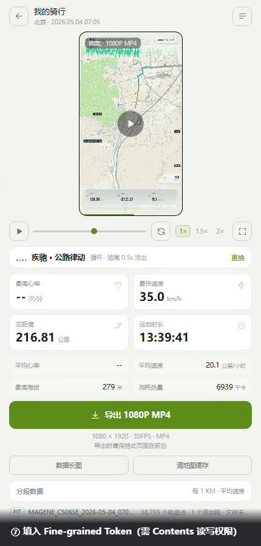
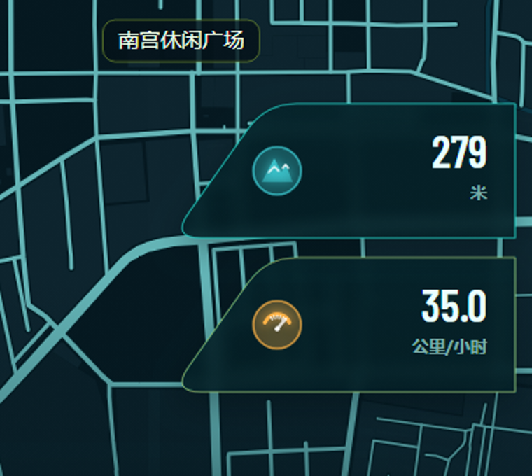
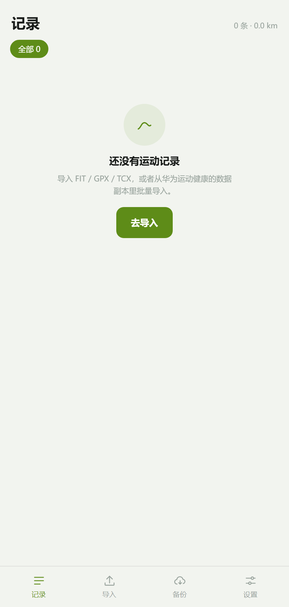
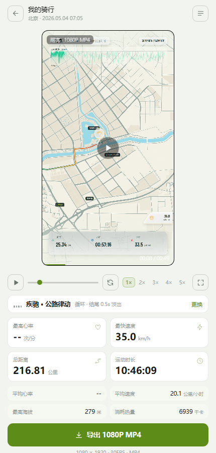
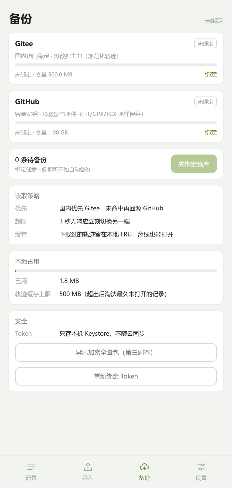

# FIT MOTION · 轨迹影像

把一条 `.fit` 或 `.gpx` 轨迹变成 **1080 × 1920 的第一视角动态运动短片**。项目完全在本地解析运动数据，不上传原始文件。


## 功能

- 上传 / 拖入 `.fit`、`.gpx`、`.tcx`，支持 Garmin、COROS、SUUNTO、Polar、Magene 等设备导出的运动文件。
- 本地解析 FIT 协议：普通消息头、压缩时间戳、大小端定义、数组、字符串、开发者字段。
- 本地解析 GPX 1.0/1.1：`trkpt` / `rtept`、海拔、时间、心率、踏频、功率、速度扩展字段。
- 本地解析 TCX：`Activity / Lap / Trackpoint`、海拔、心率、踏频、速度扩展字段。
- 支持合并多条 FIT / GPX / TCX：
  - 多文件选择后按时间拼接
  - 首页展示原始轨迹点数量与合并状态
  - 可导出新的 GPX 或 TCX 轨迹文件
- 导入后先缓存地图，缓存完成后再播放或导出：
  - 总览地图和第一视角矢量瓦片都写入 IndexedDB
  - 第一次导入显示缓存进度
  - 再次导入相同路线直接读取本地缓存
  - 导出期间不再依赖网络
- 路线不超过 300 公里时生成动态视频：
  - 第一视角使用 OpenStreetMap / OpenMapTiles 矢量瓦片，z14
  - 道路由 Canvas2D 路径绘制，不再放大栅格图片
  - 每 100 公里为一个缓存分段，预加载全部矢量瓦片后再开始
  - 最终页使用 z11 总览底图
- 路线超过 300 公里时只生成一张完整路线图：
  - 1080 × 1920 PNG
  - 不生成动态视频
  - 保留总距离、时长、速度、海拔、热量等数据
- 1080P（1080 × 1920）动态轨迹，三种整体一致的色彩模式：
  - **明亮**：暖白、湖蓝、薄荷绿与彩色街区
  - **夜间**：深蓝底、冷光湖面与霓虹轨迹
  - **科技**：青黑底、荧光青/蓝数据界面
  - 色彩模式在生成前选择，只改变色彩，不改变版式
- 底图不渲染任何地名、村庄、学校、桥梁、道路名、路口名、河流名或地铁站名；道路加深颜色提高可读性，建筑、绿地、山体用色块表达，淡蓝色地铁线不再显示。
- 左上角显示 **地点 / 开始时间 / 当前已骑行时间**；右上角显示 **当前点位经纬度**。
- 顶部下方有与轨迹同步的 **速度曲线**：
  - 背景使用主题渐变透明层，不再使用地图模糊层或白色卡片
  - 绿色曲线一开始就完整显示，移动点沿曲线前进
  - 已骑过的曲线下方渐变加深，未骑过部分保持低透明度
  - 宽度延伸到右上角经纬度胶囊的右缘
  - 上下幅度随速度大小变化，前后速度差越大波动越明显
- **第一视角跟随镜头**，不再始终展示完整路线。
- 轨迹每 **50 公里** 显示一次里程数据标记。
- 经过最高心率、最快速度、最高海拔时：
  - 地图点位弹出 **只含图标的圆形气泡**
  - 右侧下方出现 **深色半透明圆角梯形**，左侧两角圆润，右缘垂直并贴近画面右侧
  - 每一个事件单独一个梯形，彩色实心图标位于梯形内部，上下留出间隔，按发生顺序从下到上逐个弹出
  - 抽屉内只显示 **图标 + 数据 + 单位**，不显示指标名称
  - 抽屉持续到结束数据面板出现前
- 完成后自动缩放展示完整轨迹，并显示结尾数据面板。
- 最终页顶部继续悬浮 **地点/开始/当前时间、经纬度、完整速度曲线**；地图铺满面板上方，标题面板整体下移。
- 结尾 **浅色半透明数据面板**：总距离、运动时长、最快速度、最高心率、最高海拔、平均速度、消耗热量；每项带单位与彩色图标，缺少的数据自动隐藏。
- 数据卡片统一两列：偶数条时每行两列填满；奇数条时最后一个数据占两列宽。
- 视频内单位使用中文：公里、公里/小时、次/分钟、米、千卡、时:分:秒。
- 首页底部示例数据说明居中显示，适配华为 Mate 30 Pro 的 392px 宽度，不产生横向滚动。
- **视频封面与第一帧使用最后一帧的数据面板**，同时最后一帧保持不变。
- 视频中不显示设备品牌、FIT MOTION 标识或旧的活动标题，统一标题为“我的骑行 / 我的跑步 / 我的徒步”。
- 浏览器内导出 **1080P MP4**：
  - 使用 WebCodecs 逐帧编码，固定 30 FPS
  - 每帧时间戳固定为 `frameIndex / 30`，不再依赖实时录制
  - 渲染慢只会延长导出时间，不会丢帧或改变帧间隔
  - H.264 可用时直接写 MP4；不可用时写 VP8 WebM，再由 Android 原生 `MediaCodec` 转码为 MP4
- Android APK：本地 WebView 运行，支持文件选择，视频优先保存到 `Download/FIT Motion/`；Huawei/EMUI 若拒绝 MediaStore，会自动打开系统文件保存器（SAF）兜底。
- 导出过程显示“第 X / 总帧”进度，完成后统一保存。
- 编码参数优先选择硬件：`latencyMode: realtime`、`hardwareAcceleration: prefer-hardware`，关键帧间隔 150 帧，目标码率 4 Mbps。
- 编码队列超过 8 帧时等待硬件编码器消化，不再每 30 帧强制 flush，避免渲染与编码串行。
- App 图标更新为霓虹骑行图标：深色网格、荧光绿自行车与骑手，保留原有路线影像风格。
- 1080P 30FPS 使用约 5 Mbps 目标码率，30 秒文件约 18–25 MB；如果希望文件更小，可把码率降到 3.5 Mbps。
- 不额外打包 Chromium 内核：Android 系统 WebView 本身就是 Chromium，额外内核会显著增大包体且不能解决硬件编码兼容问题；当前 APK 约 1.02 MB（含内置 Magene 示例轨迹）。
- Android 返回键在视频生成页会回到首页，不会直接退出应用。

### 背景音乐

曲库不打进安装包：三首曲子由 WebAudio 离线合成，导出时实时渲染成与视频等长的 PCM，再由原生层编 AAC 混进 MP4。

| 曲目 | 气质 | BPM |
| --- | --- | --- |
| 晨风 · 轻电子 | 默认，通勤/晨骑 | 92 |
| 疾驰 · 公路律动 | 长距离骑行 | 126 |
| 落日 · 氛围 | 铺底，不抢画面 | 72 |
| 无音乐 | 静音导出 | — |

- 选曲、试听（12 秒循环）、切换都在创作页的音乐行里，选择记在 IndexedDB，下次打开还是这首。
- 预览播放跟着播放头走：暂停、拖进度、切 1.5×/2× 倍速都同步；音乐行的 EQ 随播放状态跳动。
- 导出规格：44.1 kHz 立体声 16-bit → AAC-LC 128 kbps，结尾 0.5 秒淡出；38 秒视频的 PCM 约 6.4 MB。

渲染策略上有个坑值得记一下：WebAudio 对大量短生命周期节点的处理是超线性的，38 秒整轨要十几秒才渲完。改成「渲 4/8 小节循环体 → 采样级平铺 → 叠淡入淡出」之后，同一首曲子 0.4~1.6 秒渲完，任意后续时长都是毫秒级拼接，平铺边界实测无采样跳变。

### 创作页全屏

点全屏按钮后创作页整体接管屏幕：视频按 9:16 居中、上下补黑边（不裁切片头片尾的 HUD），顶部是「退出全屏 + 标题」，底部是歌名 / 主题标签 / 更换 / 进度条 / 时间。点画面暂停，拖进度条跳转，返回键退出全屏。

布局用的是 `100vw / 100dvh` 而不是子元素的 `position: fixed; inset: 0` —— 后者在嵌套 flex 里会被解析成「父级可用空间」，量出来的高度是 9:16 的比例高度而不是视口高度。

### 示例数据

`samples/MAGENE_C506SE_2026-05-04_070531_1299461.fit` 是本次使用的 Magene C506SE 真实骑行文件，已作为首页“播放示例轨迹”的内置示例：

| 指标 | 值 |
| --- | --- |
| 最高心率 | 文件未记录，自动隐藏 |
| 最快速度 | 35.0 公里/小时 |
| 总距离 | 216.81 公里 |
| 运动时长 | 13:39:41 |
| 最高海拔 | 279 米 |
| 平均速度 | 20.1 公里/小时 |
| 消耗热量 | 6939 千卡 |

该路线超过 200 公里，视频中会出现 `50 公里`、`100 公里`、`150 公里`、`200 公里` 数据标记。

### 地图缓存与 300 公里模式

- 首次导入先下载总览 z11 和第一视角 z14 瓦片，写入 IndexedDB；缓存结束后才开始播放或导出。
- 第一视角改用矢量瓦片渲染，不再有栅格瓦片放大造成的道路锯齿。
- 矢量底图来自 OpenStreetMap / OpenFreeMap，需保留 `© OpenStreetMap contributors` 署名。
- 当前示例共约 340 张矢量瓦片，缓存后的第一视角不再放大 z11。
- 每 100 公里一个缓存分段，缓存完成后预解析全部矢量瓦片再开始播放/导出。
- 第一视角矢量地图会显示 `G104`、`G318` 这类国道编号，以及天安门广场、国家博物馆、纪念碑等著名地标图标。
- 地标和国道标签有数量上限、碰撞检测和上下安全区，最多 4 个地标 + 3 条国道，避免地图过密。
- 最后一帧全局路线图使用 64px 彩色地标插画，不画圆形底板，只保留图标本身，最多 6 个。
- 右下角事件抽屉改为白色磨砂透明：低分辨率场景快照 + 模糊 + 白色玻璃渐变，事件图标也不再画圆形底板。
- 最高心率、最快速度、最高海拔、时长、距离、均速和热量指标也改为无圆形底板的彩色图标。
- 故宫为黄顶红墙、天坛为蓝顶红身、天安门为红墙金顶、鸟巢为银色钢构、白塔为白色塔身，地标用颜色和具体轮廓区分。
- 最后一帧仍保留国道编号文字，最多 4 条；地标图标通过引导线避开中心密集区。
- 全局图内置北京故宫、天安门、国家博物馆、天坛、颐和园等精选地标，并按视口范围显示。
- 缓存不完整时不会生成模糊视频：中断后保留成功瓦片，显示“重新缓存”；联网后自动继续补齐。
- 工作室底部提供“清除地图缓存”，会同时清空总览瓦片和矢量瓦片，可重新导入路线。
- 清除缓存使用应用内深色确认弹窗，不再调用浏览器原生 `confirm`，因此不会出现 `file://` 来源标题。
- 断网时会快速失败，不会逐张等待 12–15 秒超时。
- 再次导入同一区域时，`z/x/y` 瓦片直接从本地复用。
- 路线超过 300 公里不生成视频，只渲染一张 1080×1920 路线图 PNG。

### TCX 心率检查

测试的 `20240922户外骑行.tcx` 中不含 `HeartRateBpm`、`HeartRate`、`Value` 等心率标签，也不含速度标签，因此无法显示最大心率；这不是解析丢失。界面会显示“文件未记录心率”。

示例视频：[docs/FitMotion-操作演示.mp4](docs/FitMotion-操作演示.mp4)





视频封面、第一帧与结尾数据面板共用同一帧，即顶部成片效果图。

夜间模式：


科技模式：


## 应用界面

| 记录库 | 创作页 | 备份 |
| --- | --- | --- |
|  |  |  |

## 使用与验证报告

从装机的第一次点击到每一处验证点，见 [`docs/使用与验证报告.html`](docs/使用与验证报告.html)（浏览器打开，含截图与勾选清单）。里面写了 GitHub / Gitee Token 的获取步骤和每步的预期结果。

## 快速开始

```bash
npm install
npm run build
```

构建产物是单文件 `dist/index.html`，主要供 Android APK 使用（打包时复制进 assets）。开发调试可以起本地服务：

```bash
python -m http.server 5180 --directory dist
# http://127.0.0.1:5180/
```

`?demo=1` 直接打开示例；`?demo=1&t=18.8` 打开第 18.8 秒的预览帧（包含最快速度气泡与右侧抽屉），便于检查。可追加 `&theme=night` 或 `&theme=tech` 切换色彩模式。

开发模式：

```bash
npm run dev
```

## 构建 APK

项目自带最小 Android 构建链（不依赖 Android Studio / Gradle）：

- `tools/sdk/android-11`：Android 11 (API 30) 的 `android.jar`、`aapt2`、`d8`、`zipalign`、`apksigner`
- JDK 8（默认 `D:\Jdk\jdk`，可用 `JAVA_HOME` 覆盖）
- Python 3（把 `classes.dex` 写入 APK）

```bash
npm run build
npm run android:apk
```

输出：`dist/FitMotion.apk`（约 1.02 MB，debug 自签名，minSdk 29 / targetSdk 30）。

APK 使用 `file:///android_asset/www/index.html` 加载同一份单文件 Web 应用；文件选择器、视频分块保存通过 JavaScript bridge 完成。首次安装需要允许“安装未知来源应用”。

> 自签名 APK 适合个人安装测试，不适合直接上架应用商店。

## 目录结构

```text
fit-motion/
├─ src/
│  ├─ fit/                 # FIT 解码、活动模型、统计与分段
│  ├─ gpx/ tcx/            # GPX / TCX 解码
│  ├─ render/
│  │  ├─ map.ts            # Esri 无地点文字底图、轨道线、色块艺术地图
│  │  ├─ vector-map.ts     # 矢量瓦片、跟随镜头图层、总览图层
│  │  └─ stage.ts          # 1080×1920 跟随镜头、停顿卡、结果面板
│  ├─ store/               # 记录库：IndexedDB、指纹去重、游标分页、LRU 缓存
│  │  ├─ db.ts             # 五个 object store 与事务封装
│  │  ├─ repo.ts           # 业务读写：导入落库、翻页、回源
│  │  ├─ fingerprint.ts    # 文件 SHA-256 + 运动指纹（时间/时长/距离）
│  │  ├─ thumb.ts          # 44×44 路线形状缩略图
│  │  └─ cache.ts          # 轨迹缓存预算与淘汰
│  ├─ import/              # FIT/GPX/TCX 读取、华为 JSON 容错解析、批量导入
│  ├─ backup/              # 双端备份
│  │  ├─ adapter.ts        # GitHub / Gitee Contents API
│  │  ├─ codec.ts          # 轨迹二进制编码 + gzip + base64
│  │  └─ sync.ts           # 对账、推送、按需回源
│  ├─ audio/               # 背景音乐：曲库、离线合成（循环体+平铺）、预览播放器
│  ├─ ui/                  # 外壳：四个 tab、记录列表、导入页、备份页、设置页、选曲层
│  ├─ export/              # GPX/TCX 导出、文件保存桥
│  ├─ data/sample.ts       # 内置 FIT 示例
│  ├─ geo.ts
│  ├─ main.ts              # 路由、播放器、1080P MP4 导出
│  ├─ app.css / base.css   # 外壳样式（三套主题变量）与基础组件
│  └─ style.css            # 早期样式，保留给未迁移的模块
├─ android/
│  ├─ AndroidManifest.xml
│  ├─ java/.../            # MainActivity、原生 GL 渲染、MediaCodec 导出
│  ├─ res/
│  └─ build-apk.mjs
├─ docs/                   # 使用与验证报告（HTML）
├─ prototype/              # 可点击原型
├─ screenshots/
└─ tools/                  # 构建、端到端验证、截图脚本
```

## 记录库与双端备份

导入的每一次运动都落进本机 IndexedDB，列表页只读几百字节的索引；轨迹单独存、按需拉。换手机或重装 App 后，绑定仓库同步一次就能把全部历史拉回来。

### 去重

两层指纹，先便宜后贵：

1. **文件指纹**：原始字节的 SHA-256（`crypto.subtle` 不可用时退化为双路 FNV-1a）。同一份内容换个文件名再导入，直接判重复。
2. **运动指纹**：开始时间 ±2 分钟、时长 ±2%、距离 ±2% 三项同时接近，就认为是同一趟运动。用于「码表导出的 FIT」与「华为导出的 JSON」撞车的情况。

### 云端怎么放

```text
fitmotion/
├─ manifest.json          # 全部记录的元数据（名字、距离、缩略图、统计、墓碑）
└─ tracks/<id>.fmt        # 单条轨迹，`1g.<base64>`（gzip）或 `1r.<base64>`
```

- **manifest 是索引**：几百条记录几十 KB，同步时一次读写；列表页、缩略图、统计都靠它。
- **轨迹按条存**：一条 13 小时、3.8 万点的骑行，原始 700 KB，gzip 后 362 KB，base64 文本 483 KB。只有点开某一趟时才会下载。
- 走 Contents API 而不是 Git Data API，文件内容统一是纯文本，避免二进制被服务端当文本改写。代价是每个文件一个 commit，但每个 blob 只会出现一次，仓库体积约等于数据体积。

### 编码为什么这么抠

远端格式只存「推不出来的字段」：

| 字段 | 存法 | 每点 |
| --- | --- | --- |
| 经纬度 | int32 × 1e-7 度（FIT 原生精度，约 1.1 cm） | 8 B |
| 时间 | 首点 f64 + 后续 u32 秒差 | 4 B |
| 海拔 | int16 × 0.1 m，`-32768` 表示缺失 | 2 B |
| 心率 | uint8，`0` 表示缺失 | 1 B |
| 距离 / 速度 | **不存**，读回来时按经纬度重算 | 0 B |

实测：38,795 点 → 698 KB 原始 → 362 KB gzip，纬度误差 0、海拔误差 ≤ 0.05 m、心率误差 0、时间戳精确。

### 同步怎么算

不做「队列」，做「对账」。每次同步都拿 `meta.updated` 跟 `meta.where[provider]` 比：谁的时间戳旧就推谁。队列会丢、会被系统杀掉，元数据不会，所以这个流程天然幂等，重复点十次和点一次结果一样。

- 两端并行探活，**快的先同步**；3~8 秒没响应就判它不可用，另一端顶上。
- 删除用墓碑：本地标 `deleted`，同步时删掉云端的轨迹文件，并在 manifest 里留一条 `deleted` 标记，另一台设备拉到后同样消失。
- 云端比本地新（另一端改过名、删过记录）就以云端为准；本地更新过就等会儿推上去。
- 本地轨迹超过 500 MB 时按「最久未打开」淘汰，只删轨迹，索引和缩略图都留着，点开时自动回源。

### 实测数据（Chromium，file:// 生产包）

| 场景 | 结果 |
| --- | --- |
| 首同步，双端 | 推送 2 次（两端各一份）· 备份状态 2（双端） |
| 清空本地后同步 | 拉取 1 条索引，列表恢复名称/距离/缩略图，本地不带轨迹 |
| 点开记录（回源 483 KB） | 214~366 ms 完成下载 + 解码 + 落缓存 |
| 单端故障（Gitee 500） | 仍推成功到 GitHub，状态降为「已备份」，备注写明 Gitee 异常 |
| 删除记录后同步 | 两端轨迹均被删除，两端 manifest 均留墓碑 |

## 数据口径

- **最高心率**：session `max_heart_rate`，缺失时取轨迹点最大值。
- **最快速度**：session `max_speed` / `enhanced_max_speed`，缺失时用轨迹速度计算。
- **总距离**：session `total_distance`，缺失时用 Haversine 累计。
- **运动时长**：session `total_elapsed_time`，GPX 使用首末时间差；没有时间信息时显示 `--`。
- **最高海拔**：轨迹 `ele` / `altitude` 最大值，或 session `max_altitude`。
- **平均速度**：session 平均值，或距离 / 时间；没有时间时若 GPX 自带速度字段则取平均速度。
- **消耗热量**：优先 session `total_calories`；缺失时依据距离、速度、平均心率、运动类型和 65 kg 体重估算。
- 任何无法计算或文件里不存在的字段都不会出现在结果面板。
- 多段活动选择距离最长的一段作为主活动。
- GPX 默认以“我的骑行”展示；文件 `<type>` 标明 running / hiking / walking 时自动切换标题。

## 已知限制

- Esri 无标注底图需要网络；离线时自动回退到程序化艺术地图。
- 1080P MP4 使用 WebCodecs + MP4/WebM muxer；不再依赖 `MediaRecorder` 实时录制。设备不支持 WebCodecs 时才回退到旧录制链路。
- 不支持没有 GPS 的室内活动生成轨迹。
- 地图底图与轨道叠加来自 Esri 公开栅格服务，仅用于个人演示；商用请替换为有授权的底图服务。
- **云备份需要 Token 有仓库 Contents 读写权限**；Token 只存在本机 IndexedDB，不随云同步，也不会加密后再存。
- Web 端受 CORS 限制：GitHub API 通配放行，Gitee 若拒绝跨域就只能用 APK（WebView 已开 `setAllowUniversalAccessFromFileURLs`）。
- 仓库里每个轨迹文件是一个 commit。一次导入几百条会产生几百个 commit，仓库体积不受影响，但提交历史会比较长。
- 备份名单只覆盖轨迹与统计，**不含原始 FIT/GPX 文件**；原始文件仍留在本机 `files` store。

## 技术栈

TypeScript、Canvas 2D、WebCodecs、MP4/WebM muxer、esbuild、Android WebView（原生 Java，无 AndroidX）。
