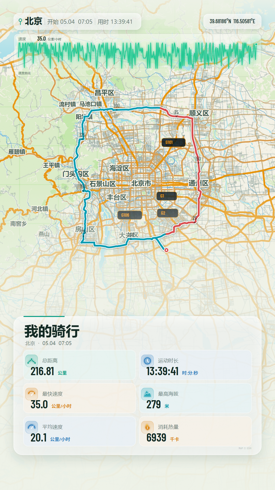
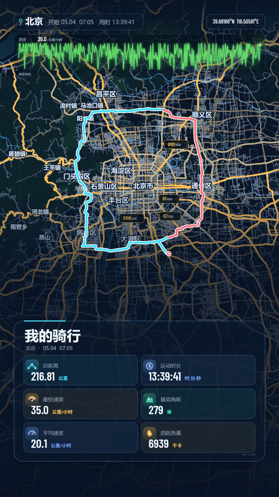
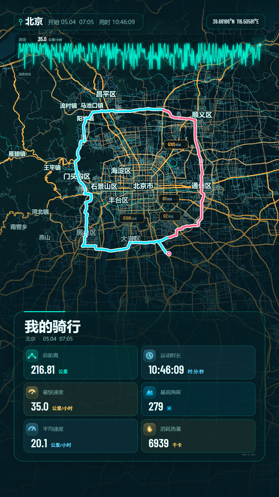

# FIT MOTION · 轨迹影像

把一条 `.fit` / `.gpx` / `.tcx` 轨迹变成 **1080 × 1920 的第一视角动态运动短片**。全部数据在本地解析，不上传原始文件。



夜间与科技模式：




## 功能总览

- **导入**：`.fit` / `.gpx` / `.tcx`（含 Garmin、COROS、SUUNTO、Polar、Magene、华为 JSON），批量导入、按时间合并多条轨迹、SHA-256 + 运动指纹双重去重。
- **记录库**：本机 IndexedDB 存储，记录页按年份分组的吸顶筛选条、缩略图路线形状、批量选择/删除/撤销。
- **创作**：三套色彩主题（明亮 / 夜间 / 科技）、1~5× 倍速、内置合成曲库或本地音乐、全屏播放、173km 级长途全程无空白。
- **导出**：
  - 视频：1080P 30FPS MP4（WebCodecs 逐帧编码，App 内走原生 MediaCodec + OpenGL）
  - 数据：GPX（含 `gpxtpx` 心率/踏频扩展）、TCX（含 Lap 平均/最大心率）、FIT、1080×1920 PNG 路线图（>300km 自动只出图）
  - 分享：系统分享面板 / 微信 / 抖音直达
- **备份**：GitHub / Gitee 双端对账式云同步，gzip 编码轨迹，墓碑删除，按需回源。

## 双渲染线架构

同一套 1080×1920 场景有两份逐帧确定性实现，产物一致：

| | Web 预览（Canvas 2D） | Android 原生（OpenGL ES） |
| --- | --- | --- |
| 预览 | `src/render/stage.ts`，rAF 驱动 | `NativePreviewView`：SurfaceView 挖洞 + EGL + 渲染线程，WebView 透明透出原生画面 |
| 成片 | WebCodecs 逐帧编码 | `NativeExporter`：MediaCodec 硬编码，约 25ms/帧 |
| 地图 | `vector-map.ts` 矢量瓦片 + IndexedDB 缓存 | `NativeVectorMap`：PBF 解析 + 磁盘/内存缓存 |

原生预览的关键设计：

- **JS 主导播放头**：音频走 WebAudio，每帧只把帧号推给原生（`nativePreviewFrame`），音画同步天然由 JS 保证。
- **4x MSAA**：路线 ribbon 是硬边几何，ES3 可用时给场景 FBO 挂多重采样渲染缓冲，resolve 时硬件高质量降采样（不支持则自动回退）。
- **与导出相同的瓦片预烤**：进页先放行渲染，后台按路线顺序并行预烤走廊瓦片（64MB 驻留预算自适应），播放中镜头永远领先烤图进度——长途不再出现"先糊后清"。
- **完整兜底**：海报模式、老版本 App、原生失败（`nativePreviewReady(false)`）自动退回网页渲染；导出期间原生预览让路，结束后恢复。

## 性能优化（实测，桌面 Chrome / 生产构建）

| 场景 | 优化前 | 优化后 |
| --- | --- | --- |
| 地图生成（创作页冷启动） | 6.0s | 2.7s（时间片让出 + 道路两 pass 共享几何 + 小位图稀疏模式） |
| 热进页（缓存命中） | 6.8s | ~0.4s（成品画布快照 + 跨实例共享解析/位图缓存，逐像素 0 差异） |
| 173km 长途播放 | 空白频发 | missBudget=0、空白像素 0（走廊分级预取 + 绝不清缓存 + 低清兜底） |
| 音画同步（低端机 8× CPU 节流） | 音乐提前 ~5s 结束 | 同步结束（播放头限幅放宽 + 限幅时音乐对齐播放头） |

## 快速开始

```bash
npm install
npm run dev      # 开发模式
npm run build    # 产出单文件 dist/index.html
```

调试参数：`?demo=1` 打开示例轨迹；`?demo=1&t=18.8` 直达第 18.8 秒帧；`&theme=night|tech` 切主题；`&still=1` 静帧模式。

### 构建 APK

自研最小构建链（不依赖 Android Studio / Gradle），需要 JDK 8+（`JAVA_HOME` 或默认 `D:\Jdk\jdk`）：

```bash
npm run build
npm run android:apk
```

输出 `dist/FitMotion.apk`（约 1.15 MB，debug 自签名，minSdk 29）。WebView 加载同一份单文件 Web 应用；文件选择、视频保存、原生渲染/导出通过 `FitMotionAndroid` JS bridge 完成。

> 注意：`android/build-apk.mjs` 的 `javaSources` 是显式列表，新增 Java 文件需手动加入。

## 测试

`tools/` 下有完整的端到端测试脚本（puppeteer-core + 本地 dev server，需 Chrome）：

```bash
python -m http.server 5178 --directory dist   # 或 npm run dev
node tools/gl-preview-bridge-test.mjs    # 原生预览桥接 13 项：payload/挖洞/帧推送/暂停/退出/双路降级
node tools/hr-export-test.mjs            # FIT/GPX/TCX 心率+踏频导出与重导入往返
node tools/music-early-end-probe.mjs     # 音乐全程覆盖；--throttle=8 模拟低端机音画同步
node tools/music-swap-ui-test.mjs        # 本地音乐选择/更换 UI 流
node tools/records-years-scroll.mjs      # 年份条滚动与渐隐
node tools/long-route-blank.mjs          # 173km 长途空白探针（missBudget/空白像素）
node tools/studio-cache-perf.mjs         # 冷/热进页性能打点
```

纯 Java 侧验证：`node android/build-apk.mjs` 内含 javac 编译检查；真机项（挖洞透明兼容性、MSAA 生效、切后台恢复）需安装 APK 人工确认。

## 目录结构

```text
fit-motion/
├─ src/
│  ├─ fit/ gpx/ tcx/        # 三格式本地解析（FIT 协议完整实现）
│  ├─ render/
│  │  ├─ map.ts             # 底图成品快照（mapSnapshot）
│  │  ├─ vector-map.ts      # 矢量瓦片、跟随/总览图层、跨实例共享缓存
│  │  └─ stage.ts           # 1080×1920 场景：镜头、HUD、结果面板
│  ├─ store/                # IndexedDB 记录库、指纹去重、缓存预算
│  ├─ import/               # 批量导入、华为 JSON 容错
│  ├─ export/               # GPX/TCX/FIT 导出（心率/踏频）
│  ├─ audio/                # 曲库、WebAudio 离线合成（循环体+平铺）、预览播放器
│  ├─ backup/               # GitHub/Gitee 对账同步
│  ├─ ui/                   # 外壳、记录页、选曲层、键盘避让
│  └─ main.ts               # 路由、播放循环、原生预览桥接、导出编排
├─ android/
│  ├─ java/com/fitmotion/app/
│  │  ├─ NativeScene.java   # 原生 GL 场景（与 stage.ts 同规格）
│  │  ├─ NativePreviewView.java  # 原生预览（SurfaceView+EGL+MSAA+预烤）
│  │  ├─ NativeVectorMap.java    # 原生矢量地图
│  │  ├─ NativeExporter.java     # MediaCodec 硬编码导出
│  │  └─ MainActivity.java       # WebView 容器 + JS bridge
│  └─ build-apk.mjs         # 最小 APK 构建链
├─ tools/                   # 构建 + 端到端测试脚本
└─ docs/ screenshots/       # 验证报告与截图
```

## 记录库与双端备份

- **两层去重**：文件字节 SHA-256 → 运动指纹（开始时间 ±2min、时长 ±2%、距离 ±2% 同时接近）。
- **云端布局**：`manifest.json`（全部索引，几十 KB）+ `tracks/<id>.fmt`（单条轨迹 gzip+base64，13 小时 3.8 万点约 483 KB）。
- **对账而非队列**：每次同步比较 `meta.updated` 与 `meta.where[provider]`，谁旧推谁，天然幂等；删除用墓碑标记；本地轨迹超 500MB 按 LRU 淘汰、索引保留、点开回源。
- Token 只存本机，不随云同步；需要仓库 Contents 读写权限。

## 数据口径

- 最高心率：session `max_heart_rate`，缺失取点最大值；文件未记录时该卡片自动隐藏。
- 最快速度 / 总距离 / 时长 / 海拔 / 热量：优先 session 字段，缺失按轨迹点计算或估算（热量按 65kg 体重 + 距离/速度/心率）。
- 导出文件完整保留心率（FIT record + lap/session 摘要、GPX TrackPointExtension、TCX Lap Average/MaximumHeartRateBpm），心率统一过滤 30~254（0xFF/未佩戴视为无效）。
- 任何文件里不存在的字段不会出现在结果面板。

## 已知限制

- 矢量底图来自 OpenStreetMap / OpenFreeMap 公开服务，需保留署名；离线时回退程序化艺术地图。
- 自签名 APK 适合个人安装，不适合上架。
- 云备份不含原始 FIT/GPX 文件（仍留本机）；Gitee 跨域受限时只能用 APK 同步。
- 仓库每个轨迹文件一个 commit，批量导入几百条会产生较长提交历史（体积不受影响）。
- 原生预览的 WebView 透明挖洞在个别 ROM 上需真机验证；失败时自动退回网页渲染，不影响使用。

## 技术栈

TypeScript、Canvas 2D、WebCodecs、WebAudio、OpenGL ES 3（MSAA）、MediaCodec、esbuild、Android WebView（原生 Java，无 AndroidX）。
